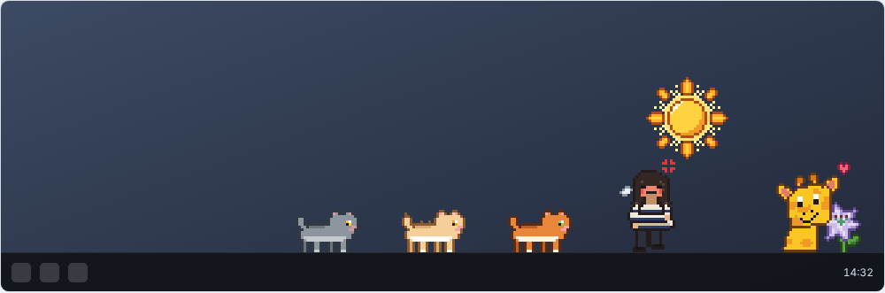

# Taskbar Kedileri 🐈

Windows görev çubuğunun hemen üzerinde, arka planı olmayan küçük bir pixel art
animasyonu. Tarçın, Maya ve Zilli, Dogis'le birlikte oynuyor, uyuyor, geziniyor.

Sıfır bağımlılık: Windows'ta hazır gelen PowerShell + WinForms dışında hiçbir şey
gerekmiyor. Python, Node, .NET SDK kurmana gerek yok.



## Çalıştırma

**`Kedileri Baslat.bat`** dosyasına çift tıkla. Hepsi bu.

Başlarken kısa bir siyah pencere görürsen normal, hemen kapanır. Hiç görünmesin
istersen `Kedileri Baslat (sessiz).vbs` dosyasını kullan; ikisi de aynı şeyi yapar.

`onizleme.html` dosyasını tarayıcıda açarsan widget'ı çalıştırmadan tüm sahneleri
ve karakterleri inceleyebilirsin.

## Kullanım

| İşlem | Nasıl |
|---|---|
| Kediyi zıplatmak | Kedinin **üzerine sol tıkla** — zıplar ve kalp çıkar |
| Menü | Kedilerden birinin **üzerine sağ tıkla** |
| Duraklatma | Sağ tık → *Duraklat* |
| Boyut | Sağ tık → *Boyut 1x / 2x / 3x* (varsayılan 2x) |
| Sahneyi atlamak | Sağ tık → *Sahneyi degistir* |
| Kapatmak | Sağ tık → *Cikis* |

> Menü ve tıklama sadece **karakterlerin piksellerinde** çalışır. Pencerenin geri
> kalanı tamamen saydamdır ve tıklamalar altındaki masaüstüne geçer — yani
> çalışmanı hiçbir şekilde engellemez.

## Sahneler

Dört sahne rastgele sırayla, 15–25 saniyede bir değişir:

- **Kortej** — Dogis yürür, kediler peşinden sıra sıra takip eder, grup ekran boyunca gezinir
- **Oyuncak** — Dogis tüylü çubuğu sallar, bir kedi zıplayıp yakalamaya çalışır
- **Sevme** — Dogis çömelir, bir kediyi sever, kalpler yükselir
- **Uyku** — kediler uzanıp uyur, biri ara ara esneyip gerinir, z'ler yükselir

Roller her sahnede karışır, yani hep aynı kedi zıplamaz.

## Windows açılışında otomatik başlatma

`Win + R` → `shell:startup` → açılan klasöre `Kedileri Baslat (sessiz).vbs`
dosyasının **kısayolunu** at. Kaldırmak için kısayolu sil.

## Bir şey ters giderse

- Widget hiç açılmıyorsa klasörde **`catbar-hata.log`** dosyasına bak; hata orada yazar.
- Kediler görünmüyor ama görev yöneticisinde `powershell.exe` varsa, muhtemelen
  ekranın solundalar — birkaç saniye bekle, kortej sahnesinde gezinirler.
- Kapatamıyorsan: Görev Yöneticisi → `Windows PowerShell` işlemini sonlandır.
- Kurumsal bir bilgisayarda PowerShell betikleri tamamen engelliyse `.bat`
  çalışmayabilir; o durumda bilgisayarın yöneticisine sorman gerekir.

---

## Nasıl çalışıyor

```
Kedileri Baslat.bat          ->  powershell -File catbar.ps1
catbar.ps1                       tek dosya: sprite sheet base64 olarak icinde gomulu
  ├─ $FRAMES                     73 karenin sprite sheet'teki hucre koordinatlari
  ├─ $ANIM / $HANIM              animasyon tablolari (kare listesi + kac tick tutacagi)
  ├─ $SCENES                     dort sahnenin hedef pozisyonlari ve animasyonlari
  ├─ Step-World                  sahne durum makinesi, 80 ms'lik tick
  └─ Form.Add_Paint              NearestNeighbor ile sprite cizimi
```

Teknik notlar:

- **Saydamlık** `Form.TransparencyKey` ile renk anahtarlı yapılıyor (magenta,
  `255,0,255`). Sprite'larda o renk hiç kullanılmıyor ve alfa değerleri yalnızca
  0 veya 255 — yani yumuşatılmış kenar yok, anahtar renk temiz çalışıyor.
  Bunun güzel yan etkisi: saydam alanlar tıklamayı altındaki pencereye geçirir.
- **Konumlandırma** `Screen.PrimaryScreen.WorkingArea` ile yapılıyor, yani görev
  çubuğu nerede olursa olsun ve DPI ölçeklemesi kaç olursa olsun doğru oturuyor.
- **Aynalama** için sprite sheet'in yatay çevrilmiş bir kopyası bellekte tutuluyor;
  kaynak koordinat `SHEET_W - x - CELL_W` ile hesaplanıyor.
- Form `DoubleBuffered` olarak işaretleniyor (reflection ile, çünkü property
  `protected`), aksi halde titriyor.

## Sprite'ları değiştirmek

```bash
cd kaynak
pip install pillow
python3 build_sheet.py    # assets/sprites.png + sprites.json
python3 mkdist.py         # dist/catbar.ps1  (sprite'lar icine gomulu)
python3 mkpreview.py      # build/preview.html
```

Üretilen `dist/catbar.ps1` dosyasını kök dizindeki `catbar.ps1` ile değiştir.

`kaynak/` içeriği:

| Dosya | İçerik |
|---|---|
| `art_cat.py` | Kedi pozları — ASCII pixel art, bacaklar programatik üretiliyor |
| `art_sleep.py` | Uyku / esneme / gerinme pozları |
| `art_human.py` | Dogis'in (insan) pozları ve efektler (kalp, zzz, kıvılcım) — sprite adları `human_*` olarak kalıyor |
| `shapes.py` | Elips / kontur yardımcıları |
| `build_sheet.py` | Paletler, kedi siluet varyantları, sprite sheet paketleyici |
| `scene.js` | Sahne durum makinesi — `catbar_tpl.ps1` ile aynı mantık |
| `catbar_tpl.ps1` | PowerShell şablonu; `mkdist.py` içine sprite'ları gömer |

> `scene.js` ile `catbar_tpl.ps1` aynı sahne mantığını taşır. Birini
> değiştirdiğinde diğerini de güncelle, yoksa önizleme widget'la uyuşmaz.

Karakter ayrımı palet + poza duyarlı siluet ile yapılıyor: Maya'ya genişletme
(dilate) ve sırtında tüy dikenleri ekleniyor, Zilli'ye yalnızca oturma
pozlarında yatay genişletme uygulanıyor — bacaklı ve uyku pozlarında uygulanırsa
bacaklar birleşip yüz bozuluyor.
